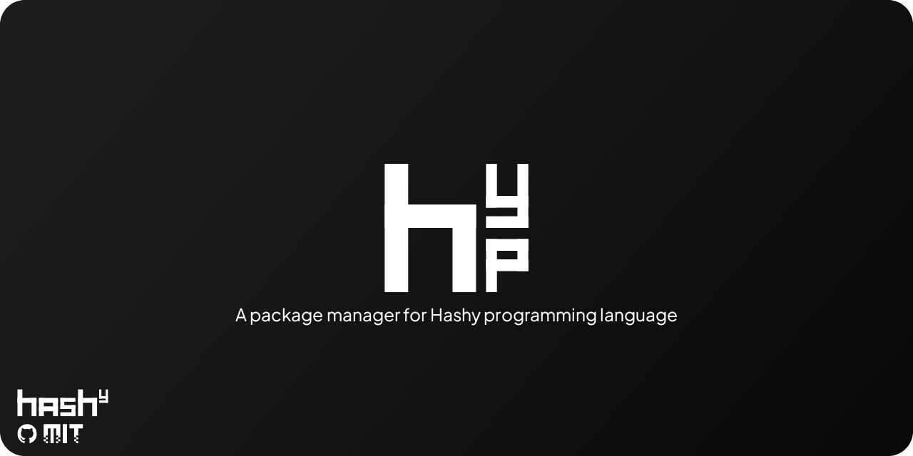

<p align="center">
  
</p>

<p align="center">
  
  
  
</p>

A package manager for Hashy programming language.
> [!WARNING]
> Hashy programming language is not yet available for use.

# How to use:
`hashypkg install package-compiler(MSVC / MinGW64)-platform@version` (@version - optional) - installs the package (if you haven't entered a version, it installs the latest one)

`hashypkg installreq requirements.txt` - installs packages specified in a text file

`hashypkg info package-compiler-platform` - displays information about the package: name, description, version, author, license

`hashypkg remove package-compiler-platform` - removes a package from hvendor

`hashypkg list` - displays all installed packages


# Packages that will be added soon:
### Rendering, graphics and window
*   **[SDL3](https://www.libsdl.org/)** - Cross-platform library for low-level access to audio, input, and graphics hardware.
*   **[SFML](https://www.sfml-dev.org/)** - Simple and fast multimedia library, providing an object-oriented interface to windowing, graphics, and audio .
*   **[Raylib](https://www.raylib.com/)** - Simple and easy-to-use library for games programming, focused on prototyping and education .
*   **[bgfx](https://github.com/bkaradzic/bgfx)** - Cross-platform, graphics API agnostic rendering library with support for many backends.
*   **[OpenGL](https://www.opengl.org/)** - The industry-standard specification for 2D/3D graphics APIs .
*   **[GLFW](https://www.glfw.org/)** - Lightweight library for managing OpenGL contexts, windows, and input .
*   **[cGLM](https://github.com/recp/cglm)** - Highly optimized math library for graphics programming in C.
*   **[TIGR](https://github.com/erkkah/tigr)** - Tiny cross-platform framebuffer library for simple 2D graphics and windows.

### 3D models
*   **[Assimp](https://assimp.org/)** - Library to import various 3D model formats in a uniform manner .
*   **[TinyGLTF](https://github.com/syoyo/tinygltf)** - Header-only C++ library to load and save glTF 3D models .
*   **[TinyOBJLoader](https://github.com/tinyobjloader/tinyobjloader)** - Header-only, single-file Wavefront OBJ loader written in C++ .

### UI
*   **[cimgui](https://github.com/cimgui/cimgui)** - Thin C-API wrapper for Dear ImGui, designed for use in other languages .
*   **[libui-ng](https://github.com/libui-ng/libui-ng)** - Portable GUI library for C that uses native technologies of each platform.
*   **[RmlUI](https://github.com/mikke89/RmlUi)** - HTML/CSS-based user interface library, a maintained fork of libRocket.
*   **[webview](https://github.com/webview/webview)** - Tiny cross-platform library for embedding a webview in native applications.
*   **[FTXUI](https://arthursonzogni.github.io/FTXUI/)** - FTXUI is a functional, C++ library for terminal-based user interfaces.

### Physics
*   **[Box2D](https://box2d.org/)** - A popular 2D physics engine for games .
*   **[Jolt Physics](https://github.com/jrouwe/JoltPhysics)** - A fast and flexible 3D physics engine written in C++, optimized for modern CPUs .

### Audio
*   **[miniaudio](https://github.com/mackron/miniaudio)** - Single-file audio playback and capture library supporting many formats.
*   **[SoLoud](https://soloud-audio.com/)** - Easy-to-use, portable C/C++ audio engine for games.

### Internet
*   **[enet](http://enet.bespin.org/)** - Thin, simple, and robust network communication layer on top of UDP .
*   **[libgit2](https://libgit2.org/)** - Portable, pure C implementation of the Git core methods as a linkable library .
*   **[libwebsockets](https://libwebsockets.org/)** - Flexible, lightweight pure C library for modern network protocols like HTTP/2 and WebSockets .
*   **[cpp-httplib](https://github.com/yhirose/cpp-httplib)** - A C++11 cross-platform HTTP/HTTPS server and client library .

### Embeddable languages
*   **[QuickJS](https://bellard.org/quickjs/)** - Small and embeddable JavaScript engine supporting the ES2020 specification .
*   **[Lua](https://www.lua.org/)** - Powerful, efficient, lightweight, embeddable scripting language .
*   **[sol2](https://github.com/ThePhD/sol2)** - Header-only C++ binding for Lua, designed for ease of use .
*   **[Wren](https://wren.io/)** - Small, fast, class-based concurrent scripting language with a C API.

### Utilities
*   **PhysFS** - Library providing abstract access to various archives for games.
*   **[stb](https://github.com/nothings/stb)** - Collection of single-file libraries for image loading, font rendering, and more.

### Tools and infrastructure
*   **[cxxopts](https://github.com/jarro2783/cxxopts)** - Lightweight C++ option parser library for command-line arguments.
*   **[spdlog](https://github.com/gabime/spdlog)** - Very fast, header-only C++ logging library.
*   **[EnTT](https://github.com/skypjack/entt)** - EnTT is a header-only, tiny and easy to use library for game programming and much more written in modern C++.

### System
*   **[libmem](https://github.com/rdbo/libmem)** - Advanced game hacking library for cross-platform memory manipulation and process interaction.

### Concurrency
*   **[Taskflow](https://github.com/taskflow/taskflow)** - Lightweight C++ task graph programming system for parallel and heterogeneous computing.

### Data and configuration
*   **[pugixml](https://pugixml.org/)** - Lightweight, simple, and fast XML parser for C++.
*   **[libconfig](https://hyperrealm.github.io/libconfig/)** - C/C++ library for processing structured configuration files.

# License:
```
MIT License

Copyright (c) [2026] [iteractiv]

Permission is hereby granted, free of charge, to any person obtaining a copy
of this software and associated documentation files (the "Software"), to deal
in the Software without restriction, including without limitation the rights
to use, copy, modify, merge, publish, distribute, sublicense, and/or sell
copies of the Software, and to permit persons to whom the Software is
furnished to do so, subject to the following conditions:

The above copyright notice and this permission notice shall be included in all
copies or substantial portions of the Software.

THE SOFTWARE IS PROVIDED "AS IS", WITHOUT WARRANTY OF ANY KIND, EXPRESS OR
IMPLIED, INCLUDING BUT NOT LIMITED TO THE WARRANTIES OF MERCHANTABILITY,
FITNESS FOR A PARTICULAR PURPOSE AND NONINFRINGEMENT. IN NO EVENT SHALL THE
AUTHORS OR COPYRIGHT HOLDERS BE LIABLE FOR ANY CLAIM, DAMAGES OR OTHER
LIABILITY, WHETHER IN AN ACTION OF CONTRACT, TORT OR OTHERWISE, ARISING FROM,
OUT OF OR IN CONNECTION WITH THE SOFTWARE OR THE USE OR OTHER DEALINGS IN THE
SOFTWARE.
```
